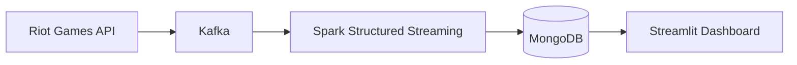

# Laura Solé Català

  <strong>Data Engineer</strong> · Python · Spark · Kafka · SQL

  <strong>🌐 Languages</strong> 
  
  

  <strong>✉️ Contact</strong> 
  
  

## About me

Computer engineer with a master's degree in Big Data and Data Engineering. I build streaming pipelines that take data from the source all the way to a dashboard. I also work as a teacher: I enjoy sharing what I learn and learning from others.

## What I've built

- End-to-end streaming pipeline: Riot Games API → Kafka → Spark Structured Streaming → MongoDB → Streamlit
- Ingestion from an external, rate-limited API
- Reproducible deployment with Docker and Docker Compose

## Technologies

  
  
  
  
  
  
  

## Featured project

### [LoL RealTime Analytics](https://github.com/laurasc14/TFM-LoL-RealTime-Analytics)

Real-time analytics platform for League of Legends matches. Master's thesis at Universidad Complutense de Madrid (2025).

- **Throughput:** over 200 events per second in local tests
- **Average latency:** ~1.8 seconds end to end
- **Features:** summoner search, aggregated champion statistics and match history
- **Next step:** cloud deployment (GCP/AWS/Azure) to validate scalability

## Education

- **Master's Degree in Big Data and Data Engineering**: Universidad Complutense de Madrid, 2024–2025
- **Bachelor's Degree in Computer Engineering**: Universitat Oberta de Catalunya, 2020–2025
- **Master's Degree in Teacher Training**: UTAMED, in progress

---

<em>Data helps us understand the present; curiosity helps us imagine what comes next.</em>

