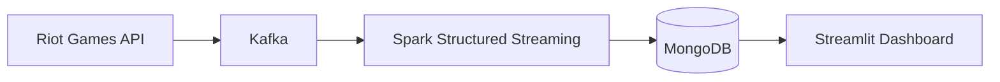

# Laura Solé Català

  <strong>Data Engineer</strong> · Python · Spark · Kafka · SQL

  
  
  

## Sobre mí

Ingeniera informática con máster en Big Data y Data Engineering. Construyo pipelines de streaming que llevan datos desde la fuente hasta un dashboard. Además, trabajo como docente, así que documento y explico lo que construyo para que otra persona pueda mantenerlo.

## Qué he construido

- Pipeline de streaming de extremo a extremo: Riot Games API → Kafka → Spark Structured Streaming → MongoDB → Streamlit
- Ingesta desde una API externa con límites de peticiones
- Despliegue reproducible con Docker y Docker Compose

## Tecnologías

  
  
  
  
  
  
  

## Proyecto destacado

### [LoL RealTime Analytics](https://github.com/laurasc14/TFM-LoL-RealTime-Analytics)

Plataforma de analítica en tiempo real sobre partidas de League of Legends. Trabajo de Fin de Máster en la Universidad Complutense de Madrid (2025).

- **Throughput:** más de 200 eventos por segundo en pruebas locales
- **Latencia media:** ~1,8 segundos de extremo a extremo
- **Funcionalidades:** búsqueda de invocadores, estadísticas agregadas de campeones e historial de partidas
- **Siguiente paso:** despliegue en la nube (GCP/AWS/Azure) para validar la escalabilidad

## Formación

- **Máster en Big Data y Data Engineering**: Universidad Complutense de Madrid, 2024–2025
- **Grado en Ingeniería Informática**: Universitat Oberta de Catalunya, 2020–2025
- **Máster de Formación del Profesorado**: UTAMED, en curso
